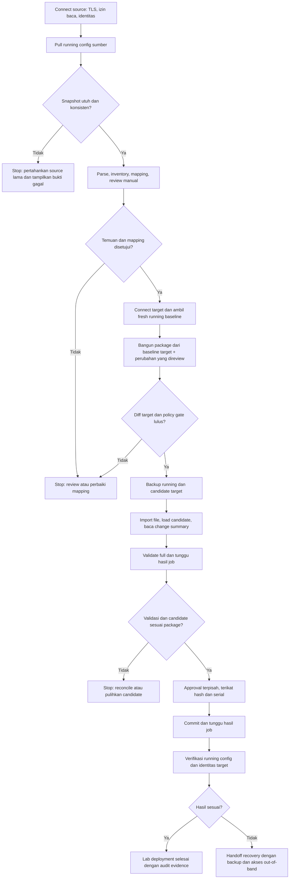

# Rencana Collect dan Push Konfigurasi PAN-OS melalui XML API

Status dokumen: `Proposed`

Target awal: migrasi langsung dari satu firewall Palo Alto sumber ke satu firewall Palo Alto tujuan di lab

Di luar target awal: Panorama, HA pair, production deployment, dan multi-user approval

Keputusan urutan kerja: pengujian ke perangkat Palo Alto fisik/virtual dilakukan **setelah seluruh fitur dalam scope rilis awal selesai diimplementasikan** dan gerbang `Implementation Complete (offline)` lulus. Sebelum itu, pengujian memakai unit test, fake PAN-OS server, dan browser UAT dengan fixture. `Implementation Complete` menyatakan kode dan alur UI selesai, bukan bukti perangkat lab berhasil atau izin production deployment.

## 1. Tujuan

Menambahkan workflow migrasi dari firewall PAN-OS lama ke firewall PAN-OS baru. ConfigHop mengambil running configuration perangkat sumber melalui XML API, memasukkannya ke pipeline analisis yang saat ini menerima upload XML, lalu engineer meninjau mapping dan perubahan di dashboard. Hasil review menjadi dasar deployment package untuk perangkat tujuan.

Alur utama: `Connect source -> Collect running config -> Parse/Analyze -> Manual review -> Connect target -> Fresh target baseline -> Build/review target package -> Backup -> Stage/Validate -> Approve/Commit -> Verify`.

Urutan request, bukti per gerbang, dan checklist implementasi ada di [bagian 14](#14-flow-teknis-dan-checkpoint-implementasi). Bagian itu adalah runbook rancangan untuk lab, bukan tanda bahwa koneksi perangkat sudah tersedia di aplikasi.

Upload XML manual tetap menjadi jalur input alternatif. Asal source (`API_COLLECTED` atau `FILE_UPLOADED`) harus terlihat pada project dan hasil review.

Workflow baru dapat disebut `Lab Available` jika sistem dapat:

1. mengambil snapshot running configuration perangkat sumber tanpa memodifikasinya;
2. membuktikan asal snapshot melalui serial, model, PAN-OS version, waktu collect, dan SHA-256;
3. menjalankan analisis serta review manual yang sama untuk source dari API maupun file;
4. membuktikan identitas dan kompatibilitas target yang berbeda dari sumber;
5. mengambil backup target sebelum mutasi;
6. mengunggah dan memuat konfigurasi sebagai candidate, tanpa langsung mengaktifkannya;
7. menjalankan validasi PAN-OS dan menampilkan seluruh warning/error;
8. meminta approval terpisah sebelum commit;
9. memantau job commit sampai hasil akhir;
10. memverifikasi perangkat setelah commit;
11. menyediakan recovery yang telah diuji di lab dan audit trail yang tidak berisi secret.

## 2. Baseline Repo Saat Ini

| Area | Status sekarang | Dampak ke fitur push |
|---|---|---|
| Candidate generation | `Available` untuk target/render path yang sudah dikualifikasi | Menjadi input deployment, tetapi belum otomatis layak di-load ke device |
| Candidate validation lokal | `Available` | Hanya membuktikan parsing, inventory expectation, dan preservation scope lokal |
| Source XML upload | `Available` | Tetap tersedia sebagai alternatif collect; parser dan review harus memakai satu jalur validasi |
| Source API collection | `Partial` | Backend, UI read-only, ownership sesi, audit SQLite, serta source snapshot durable tersedia; pembuktian perangkat lab belum selesai |
| Live firewall connection | `Partial` | XML API client dan connection test tersedia untuk endpoint IP/port allowlist; belum pernah diuji ke perangkat nyata |
| Project state | `Partial`: metadata, artifact, dan state engine internal durable pada satu proses lokal | Project, snapshot, candidate, paket, dan hash pemilik sesi dipulihkan setelah restart; koordinasi multi-worker, alur review/approval nyata, dan eksekusi deployment belum tersedia |
| Raw source access | `Available` dalam scope lokal: hidden default, explicit reveal/download, ownership sesi, dan audit backend | Audit `ACCESS_GRANTED` menunjukkan izin akses, bukan konfirmasi seluruh byte diterima browser |
| App authentication/RBAC | `Partial`: cookie sesi `HttpOnly` membatasi seluruh route proyek ke browser pembuat | Login akun, identitas operator manusia, dan RBAC belum tersedia; aplikasi tetap localhost |
| Device validation/commit | `Unavailable` | Harus dibuat sebagai state machine asynchronous |
| Rollback teruji | `Unavailable` | Production gate tidak boleh dibuka |

Catatan penting: validasi candidate saat ini tidak membuktikan bahwa full configuration aman untuk target. Sebelum live load, perlu pemeriksaan khusus agar source-local settings seperti management interface, hostname, HA, admin, certificate, master-key-dependent secret, licensing-related identity, dan Panorama ownership tidak ikut menggantikan setting lokal target tanpa keputusan eksplisit.

## 3. Keputusan Arsitektur

### 3.1 Scope rilis pertama

Rilis pertama mendukung:

- direct connection ke satu firewall sumber dan satu firewall tujuan melalui management interface;
- HTTPS PAN-OS XML API;
- API key sumber dengan izin baca saja dan API key tujuan dengan izin sesuai tahap deployment, keduanya dikirim melalui header `X-PAN-KEY`;
- collect running configuration sumber sebagai default; file upload manual tetap tersedia;
- identitas sumber dan tujuan yang berbeda, dengan provenance dan hash snapshot yang terlihat di dashboard;
- target standalone/non-HA yang memiliki out-of-band management;
- full candidate import/load hanya setelah deployability gate lulus;
- tahap `Upload + Load + Validate` terpisah dari `Commit`;
- satu active deployment per serial number.

Rilis pertama tidak mendukung:

- Panorama atau `commit-all`;
- HA active/passive atau active/active;
- browser langsung memanggil firewall;
- username/password key generation dari UI;
- HTTP plaintext;
- TLS verification yang diam-diam dinonaktifkan;
- blind retry untuk import, load, commit, atau rollback;
- auto-commit setelah upload;
- klaim rollback otomatis jika management connectivity hilang;
- pengambilan uncommitted source candidate sebagai input migrasi otomatis; operator dapat meninjaunya sebagai temuan, tetapi baseline migrasi adalah running config.

### 3.2 Jalur komunikasi

```text
Browser UI
   |  localhost API, secret hanya dikirim saat membuat session
   v
ConfigHop FastAPI
   |  HTTPS + X-PAN-KEY + certificate verification/pinning
   v
PAN-OS XML API
```

Browser tidak menyimpan API key di `localStorage`, URL, project JSON, atau log. Backend memberi secret handle terpisah dan ber-TTL untuk source dan target. Source handle hanya mengizinkan operasi baca yang dibutuhkan collect, sedangkan target handle mengikuti tahap deployment. Untuk MVP lokal, secret vault dapat berupa memory-only store; sebelum production, ganti dengan OS credential manager atau external secret manager.

Source collection dan target deployment memakai koneksi yang berbeda. Project menyimpan identitas kedua perangkat, tetapi tidak menyimpan API key. Penghapusan project harus mencabut handle yang masih hidup.

### 3.3 State machine source collection dan deployment

Source collection punya state terpisah dari deployment: `SOURCE_EMPTY -> SOURCE_CONNECTING -> SOURCE_COLLECTING -> SOURCE_VERIFYING -> SOURCE_READY`, dengan terminal error `SOURCE_COLLECT_FAILED` atau `SOURCE_REVIEW_REQUIRED`. `SOURCE_READY` berarti XML telah diterima dan diparse; status itu belum berarti candidate siap di-deploy. Pada file upload, jalur parse yang sama menghasilkan `SOURCE_READY` dengan provenance berbeda.

Perubahan source snapshot, source profile, target profile, mapping, atau review harus menginvalidasi deployment package yang belum distage. Deployment yang sudah distage tetap memiliki snapshot immutable dan tidak boleh diam-diam memakai project state terbaru.

```text
CREATED
  -> PREFLIGHT_PASSED
  -> BACKUP_CAPTURED
  -> IMPORTED
  -> CANDIDATE_LOADED
  -> VALIDATING
  -> VALIDATED
  -> AWAITING_COMMIT_APPROVAL
  -> COMMIT_QUEUED
  -> COMMIT_RUNNING
  -> VERIFYING
  -> SUCCEEDED
```

Setiap tahap dapat berakhir pada `FAILED_SAFE`, `FAILED_NEEDS_OPERATOR`, atau `CANCELLED`. Recovery memakai state terpisah: `RECOVERY_REQUESTED -> BACKUP_LOADED -> RECOVERY_VALIDATING -> RECOVERY_COMMITTING -> RECOVERED`. Jangan memberi label `ROLLED_BACK` hanya karena backup tersedia; label itu hanya boleh digunakan setelah restore, commit, dan verification berhasil.

## 4. Workflow End-to-End

### 4.1 Connect source dan collect konfigurasi

Pada section `Source Configuration`, sediakan pilihan `Collect from firewall` dan `Upload XML`. Untuk collect, operator mengisi host/IP sumber, port, API key baca, serta CA certificate atau certificate fingerprint. Setelah `Test source connection`, UI menampilkan hostname, serial, model, PAN-OS version, dan TLS identity agar operator dapat memastikan perangkat yang benar.

Urutan collect read-only:

1. Validasi host/port, DNS, TLS identity, API permission, dan system info. Source harus direct firewall yang sesuai scope awal. Baca pending change summary bila API role mengizinkan, lalu beri warning bila candidate sumber berbeda dari running config.
2. Ambil snapshot **running configuration** lengkap melalui XML API `type=export&category=configuration`, dengan parameter snapshot yang dibuktikan pada versi PAN-OS lab. Simpan body sebagai XML config, bukan XML response wrapper. Alternatif `type=config&action=show` hanya dipakai jika bentuk outputnya terbukti setara dan kompatibel dengan parser; `action=get` merujuk candidate configuration dan tidak boleh diam-diam menjadi baseline migrasi.
3. Batasi ukuran dan waktu respons, tolak HTTP/XML API error, parse XML secara aman, lalu hitung SHA-256 dari byte mentah sebelum normalisasi.
4. Ambil system info lagi setelah export untuk memeriksa serial/model. Untuk mendeteksi perubahan running config selama collect, bandingkan revision/commit identifier sebelum dan sesudah bila tersedia dan terbukti pada versi lab; bila tidak, export ulang dan bandingkan hash kedua hasil. Ketidakcocokan menandai `COLLECT_REVIEW_REQUIRED` dan mencegah promosi snapshot.
5. Cocokkan model dari system info dengan exact source hardware profile di registry dan bandingkan PAN-OS version perangkat dengan metadata XML. Tampilkan hasilnya untuk konfirmasi operator; mismatch atau model tak dikenal memblokir candidate. Masukkan snapshot ke jalur parse, inventory, compatibility, preview, dan candidate yang sama dengan upload file. Penggantian source harus menghapus hasil review, mapping, dan candidate lama melalui invalidation yang sama.
6. Simpan `SourceSnapshot` immutable: origin `API_COLLECTED`, endpoint tanpa secret, hostname, serial, model, PAN-OS version, timestamp UTC, jenis snapshot `RUNNING`, ukuran, SHA-256, TLS fingerprint, parser status, dan warning. Untuk upload manual, isi origin `FILE_UPLOADED` dan jangan mengarang serial perangkat; deployment dari file memerlukan identitas source yang dibuktikan secara terpisah.

Jika collect gagal, project mempertahankan source sebelumnya sampai snapshot baru selesai diunduh, diparse, dan dipromosikan secara atomik. Error UI harus membedakan kegagalan koneksi, izin export, TLS, ukuran, format, dan perubahan perangkat sumber. Collect ulang menghasilkan snapshot baru, bukan menimpa bukti snapshot lama; review sebelumnya tidak berlaku sampai operator meninjau diff kedua snapshot.

Config yang dikumpulkan dapat berisi secret. Simpan artifact secara terenkripsi atau gunakan working file berumur pendek dengan akses terbatas untuk parser. Raw XML preview/download memerlukan aksi eksplisit dan masking secret secara default. Audit dan event stream hanya menampilkan metadata serta hash.

### 4.2 Connect target dan preflight read-only

UI meminta:

- hostname/IP target;
- port, default `443`;
- API key;
- CA certificate atau certificate fingerprint jika target memakai internal/self-signed certificate;
- change ticket/reference opsional untuk lab dan wajib pada production phase;
- expected serial/model dari operator.

Backend melakukan read-only checks:

1. resolve target dan menolak redirect;
2. melakukan TLS verification atau exact fingerprint pinning;
3. memanggil system info untuk hostname, serial, model, PAN-OS version, uptime, dan mode device;
4. membandingkan model/PAN-OS dengan target profile project;
5. mendeteksi Panorama-managed status, HA status, dan multi-vsys;
6. membaca commit jobs, commit locks, pending changes, dan change summary;
7. memastikan tidak ada job atau candidate milik operator lain yang akan tertimpa;
8. mencatat capability matrix perangkat berdasarkan respons aktual, bukan hanya model catalog.

Hard block pada rilis awal:

- serial/model tidak sesuai dengan konfirmasi operator atau project;
- serial target sama dengan serial source yang telah di-collect;
- provenance file upload tidak mempunyai bukti serial source yang cukup untuk memastikan target berbeda;
- target adalah Panorama atau managed-only path yang belum didukung;
- HA aktif;
- ada pending candidate changes yang bukan milik workflow ini;
- ada commit/validate job aktif atau commit lock yang tidak dimiliki ConfigHop;
- candidate project berstatus `BLOCKED`, tidak tersedia, atau SHA-256 berubah;
- source snapshot berubah atau review belum terikat ke SHA-256 source snapshot terbaru;
- target running configuration berubah setelah baseline dipakai membangun deployment package; bangun ulang package dan minta review final diff;
- target render support bukan path yang sudah dikualifikasi;
- TLS identity tidak valid;
- out-of-band recovery belum dikonfirmasi.

### 4.3 Review manual dan deployability gate

Dashboard menampilkan provenance source di samping inventory, target profile, mapping antarmuka, dependency findings, semantic diff, dan raw comparison yang aman. Engineer harus menandai temuan review satu per satu; status `REVIEW_REQUIRED` tidak otomatis menjadi izin deploy. Keputusan review diikat ke source snapshot hash, pilihan target profile, mapping, renderer version, dan candidate hash. Perubahan pada salah satu input membatalkan keputusan lama.

Sebelum membuat deployment package, bandingkan source snapshot dengan versi sumber terbaru jika operator memilih `Recollect source`. Bila hash berubah, tampilkan diff dan minta review ulang. Jangan mengambil ulang source secara diam-diam saat staging, karena paket yang di-approve harus berasal dari snapshot yang terlihat di dashboard.

Sebelum upload, buat `Deployment Package` immutable yang berisi:

- project ID dan deployment ID;
- source snapshot origin, source serial (jika API collected), waktu collect, serta source, candidate, dan package SHA-256;
- target serial, model, PAN-OS version, dan hostname;
- exact mapping dan semantic diff;
- daftar accepted review findings;
- renderer/evidence version;
- target-local nodes yang dipertahankan atau sengaja diganti;
- timestamp dan actor/approval metadata.

Tambahkan policy validator untuk membandingkan candidate dengan running config target. Default-nya memblokir perubahan pada:

- management plane connectivity;
- device identity/hostname yang tidak dinyatakan;
- admin accounts dan authentication profile;
- HA configuration;
- Panorama/server ownership;
- certificates/private keys dan encrypted secrets;
- service route atau management access yang dapat memutus jalur API;
- virtual system topology di luar migration scope.

Keputusan implementasi yang direkomendasikan adalah membangun deployable candidate di atas fresh target running config, lalu menerapkan perubahan migrasi yang sudah direview. Transformation plan saat ini ditujukan ke XML source, sehingga perlu layer baru yang memetakan objek source ke target dan memeriksa precondition target. Jangan menerapkan source plan langsung pada target atau mengimpor full source-derived candidate sampai equivalence dan target-local preservation dapat dibuktikan. Diff final harus membandingkan deployable candidate dengan fresh target baseline, dan operator meninjaunya sebelum staging.

### 4.4 Backup sebelum mutasi

Ambil dan simpan sebagai artifacts:

- running configuration target;
- candidate configuration sebelum deployment;
- device state jika tersedia dan sesuai scope;
- system info;
- pending change summary;
- daftar job dan lock;
- hash, timestamp, target serial, dan TLS fingerprint.

Backup harus selesai, dapat diparse, memiliki hash, dan lolos size limit sebelum upload dimulai. Artifact disimpan terenkripsi at rest pada data directory lokal dan tidak diletakkan di repository.

### 4.5 Upload, load, dan validate

Urutan XML API:

1. `type=import&category=configuration` untuk mengunggah file dengan nama unik berbasis deployment ID;
2. `type=op` dengan `load config from <filename>` untuk memuat file ke candidate configuration;
3. baca change summary dan bandingkan dengan approved deployment package;
4. `type=op` dengan `validate full`;
5. poll job ID sampai terminal status atau timeout;
6. simpan warnings/details lengkap dan tampilkan hasilnya di UI.

Jika import atau load memiliki hasil ambigu karena timeout/network loss, jangan mengulang mutation secara otomatis. Reconnect, baca candidate/change summary, lalu tentukan apakah operasi sudah terjadi.

Jika validasi gagal, commit tetap tidak tersedia. Operator dapat memilih `Restore pre-deployment candidate` yang memuat kembali backup candidate, tetapi hasil baru dinyatakan pulih setelah verification berhasil.

### 4.6 Approval dan commit

Commit adalah aksi terpisah. UI harus meminta operator:

- membaca validation result dan warnings;
- memasukkan ulang target hostname atau suffix serial;
- mengonfirmasi candidate SHA-256/package SHA-256;
- mengisi alasan/change ticket;
- menyatakan out-of-band access tersedia.

Backend membuat approval token one-time dengan TTL dan mengikatnya ke deployment ID, source snapshot hash, target serial, target baseline hash, candidate hash, actor, serta change summary hash. Perubahan apa pun setelah approval membatalkan token. Sebelum commit, cek ulang target candidate/change summary agar perubahan operator lain tidak ikut ter-commit.

Commit menggunakan XML API `type=commit`, menangkap job ID, lalu mem-poll `show jobs id`. Status `success` dari request enqueue bukan bukti commit selesai. Deployment baru `SUCCEEDED` setelah job result sukses dan post-commit verification lulus.

### 4.7 Post-commit verification

Minimum verification:

- API target kembali reachable;
- serial, model, dan hostname masih sesuai;
- running configuration hash/semantic projection cocok dengan approved package;
- tidak ada unexpected pending changes;
- expected interfaces, zones, virtual routers, routes, objects, dan policies ditemukan;
- commit warnings disimpan dan ditampilkan;
- management path tetap tersedia.

Functional dataplane checks seperti routing adjacency, tunnel, HA, policy hit, dan traffic synthetic tetap `Planned` sampai ada test harness lab. UI tidak boleh menyebut deployment “healthy” jika yang terbukti hanya configuration commit.

## 5. Backend Design

Struktur modul yang disarankan:

```text
backend/src/confighop_deploy/
  client.py          # HTTP transport, TLS, timeout, redaction
  xml_response.py    # defused XML parsing dan PAN-OS error normalization
  commands.py        # typed request builders
  credentials.py     # opaque secret handle + TTL
  collection.py      # read-only source export dan consistency checks
  policy.py          # source/target preflight dan deployability gates
  artifacts.py       # source/backup/package storage + hashing/encryption
  models.py          # deployment, event, approval, artifact metadata
  repository.py      # SQLite persistence
  orchestrator.py    # state transitions dan reconciliation
  verifier.py        # pre/post-commit verification
```

Di `confighop_api`, ekstrak ingest XML saat ini dari `upload_source()` menjadi service bersama untuk file upload dan API collection. Service hanya mempromosikan source baru setelah validasi selesai dan harus menyimpan `SourceSnapshot` bersama project. Pertahankan existing source jika collect gagal. UI dan API harus membaca provenance ini dari `ProjectView`/`SourceView`. Endpoint download source yang sekarang tersedia harus mengikuti aturan masking/reveal dan akses yang sama setelah source API collection diaktifkan.

Aturan client:

- HTTPS only;
- API key di `X-PAN-KEY`, bukan query string;
- `POST` untuk request yang berisi sensitive data;
- connect/read/overall timeout terpisah;
- maximum response, source export, dan upload size;
- XML parsing dengan entity expansion disabled;
- no redirects;
- structured error mapping dari HTTP error, XML `<response status="error">`, dan job failure;
- redact API key, credentials, full XML secret nodes, dan sensitive query/body fields;
- retry otomatis hanya untuk safe read/poll dengan backoff dan jitter;
- mutation memakai idempotency/reconciliation logic, bukan blind retry.
- source export harus memisahkan respons file XML dari `<response status="error">`; jangan menganggap HTTP 200 sebagai export berhasil.

Persistence minimum:

- SQLite untuk source snapshot metadata, deployment, state transitions, device identity, approvals, dan event audit;
- encrypted artifact directory untuk source snapshot, backup, dan deployment package;
- per-device advisory lock berdasarkan serial;
- startup reconciliation untuk job berstatus non-terminal;
- retention policy dan explicit delete/export audit action.

## 6. API Contract ConfigHop

Endpoint yang disarankan:

| Method | Endpoint | Fungsi |
|---|---|---|
| `POST` | `/api/v1/device-sessions/test` | Test koneksi dengan `role=source` atau `role=target`, kembalikan identity/capabilities dan secret handle ber-TTL |
| `POST` | `/api/v1/projects/{project_id}/source/collect` | Export running config dari source handle, parse melalui ingest bersama, simpan provenance dan hash |
| `GET` | `/api/v1/projects/{project_id}/source/provenance` | Baca asal, identitas, snapshot kind, hash, waktu, dan status tanpa raw XML atau secret |
| `POST` | `/api/v1/projects/{project_id}/deployment-packages` | Freeze candidate, hashes, target identity, diff, dan review decisions |
| `POST` | `/api/v1/deployments` | Buat deployment dari package dan secret handle |
| `POST` | `/api/v1/deployments/{id}/preflight` | Jalankan checks read-only |
| `POST` | `/api/v1/deployments/{id}/stage` | Backup, import, load, dan validate |
| `GET` | `/api/v1/deployments/{id}` | Status/state/event summary |
| `GET` | `/api/v1/deployments/{id}/events` | Poll/SSE event stream tanpa secret |
| `POST` | `/api/v1/deployments/{id}/approval` | Buat approval terikat hash dan TTL |
| `POST` | `/api/v1/deployments/{id}/commit` | Enqueue commit menggunakan approval token |
| `POST` | `/api/v1/deployments/{id}/reconcile` | Read-only recovery setelah ambiguous network result |
| `POST` | `/api/v1/deployments/{id}/recover` | Load/validate/commit backup melalui workflow recovery |
| `POST` | `/api/v1/deployments/{id}/cancel` | Cancel hanya pada state yang aman |

`POST /source/collect` mengubah project lokal, tetapi hanya melakukan operasi read-only pada firewall sumber. Endpoint itu memakai `Idempotency-Key` untuk mencegah collect ganda yang tidak disengaja. Semua mutation deployment juga menerima `Idempotency-Key`. API mengembalikan `409` untuk transition yang salah, `423` untuk device lock, `422` untuk failed gate, dan error code domain yang stabil. API key atau raw secret tidak pernah dikembalikan dalam response.

## 7. UI Plan

Perbarui section `Source Configuration` yang sudah ada, lalu tambahkan section deployment setelah `Migration Results`. Progression yang terlihat di dashboard:

1. `Choose source`: pilih `Collect from firewall` atau `Upload XML`; kedua jalur berakhir pada inventory yang sama.
2. `Connect source`: isi host, port, API key baca, dan CA/fingerprint; `Test source connection` menampilkan identitas perangkat.
3. `Collect running config`: tampilkan progress export, status parse, ukuran, waktu collect, SHA-256, dan provenance. Jika collect gagal, source lama tetap terlihat dengan label yang jelas.
4. `Review migration`: tampilkan source dan target model, mapping manual, warnings, semantic diff, serta keputusan engineer yang terikat ke snapshot hash.
5. `Candidate ready`: tampilkan candidate SHA, target profile, findings, dan deployability status.
6. `Connect target`: host, port, API key target, CA/fingerprint, expected serial, dan tombol `Test target connection`.
7. `Preflight`: identity target, locks/jobs, pending changes, HA/Panorama status, dan hard blockers.
8. `Stage candidate`: backup, upload, load, change summary, serta validate progress.
9. `Awaiting approval`: validation output, warnings, exact target confirmation, dan change ticket.
10. `Commit`: job queue/running progress dengan timestamps.
11. `Verify`: evidence per check dan final state.
12. `Recovery`: tampil bila state mendukung recovery, dengan dampak dan confirmation terpisah.

UI state wajib:

- source empty, source connecting, collecting, parsing, source review required;
- target connecting, staging, polling, awaiting approval, committing, verifying;
- success;
- source authentication/export/TLS/format errors;
- validation failed;
- connection lost dengan hasil mutation ambigu;
- device busy/locked;
- credentials expired;
- recovery required;
- audit/export available.

Tombol harus menyatakan aksi aktual: `Test Source Connection`, `Collect Running Config`, `Test Target Connection`, `Back Up and Stage Candidate`, `Validate on Firewall`, dan `Commit Validated Candidate`. Tampilkan source serial dan target serial bersamaan pada confirmation. Jika keduanya sama, hentikan alur.

## 8. Security Requirements

- Tetap bind backend ke `127.0.0.1` selama belum ada app authentication dan RBAC.
- Tambahkan production feature flag yang default-nya `off`, misalnya `CONFIGHOP_LIVE_DEPLOYMENT=disabled`.
- Tambahkan allowlist/denylist source dan target network serta proteksi SSRF; resolve DNS sekali per session dan verifikasi peer address.
- Jangan menerima URL lengkap dari UI; terima host dan port terstruktur.
- API key tidak boleh masuk access log, exception, telemetry, browser storage, screenshot artifact, atau audit payload.
- Gunakan least-privilege PAN-OS admin role terpisah: source hanya untuk system info/config export dan read-only checks; target untuk op, import/export, config read, dan commit sesuai phase.
- Certificate verification default wajib. Lab override hanya melalui explicit fingerprint pinning yang terlihat di UI dan audit.
- Rate-limit connection test dan secret failures.
- Encrypt source XML, target backups, dan deployment package; sediakan retention/delete policy. Raw config bisa memuat password hash, shared secret, dan private material.
- Mask raw XML di dashboard secara default; batasi raw download/reveal dan jangan kirim XML penuh ke telemetry atau error response.
- Audit setiap state transition, actor, source/target serial, artifact hash, approval, request category, response code, dan job ID tanpa menyimpan secret.

## 9. Delivery Phases

### P0: Implementasi source collection dan no-mutation connectivity

- Metadata source snapshot, deployment model, state machine, audit event, dan device lock.
- Secure XML API client, response parser, redaction, TLS pinning, dan timeout policy.
- API source collection untuk running config, provenance, dan parser ingest bersama dengan file upload.
- UI `Collect from firewall`, `Test Source Connection`, source identity, snapshot status, dan read-only target preflight.
- Penyimpanan source XML terenkripsi atau working file berumur pendek dengan akses terbatas, serta masking pada raw preview/download.
- Fake PAN-OS server untuk deterministic source export dan target read-only tests.
- Live deployment feature flag tetap `off`.

Exit gate offline: fake PAN-OS source menghasilkan inventory yang setara dengan upload fixture XML yang sama; snapshot hash, waktu, dan serial terlihat; collect gagal tidak mengganti source lama; identity source dan target dari fixture terbaca; log scan tidak menemukan API key atau raw XML. Belum ada koneksi ke perangkat.

### P1: Implementasi staging tanpa commit

- Immutable deployment package dan deployability policy.
- Manual review mengikat keputusan engineer ke source snapshot hash, target profile, dan mapping; recollect menginvalidasi review/package lama.
- Build deployable candidate dari fresh target running config dengan source-to-target mapping yang telah direview dan final diff terhadap target.
- Running/candidate backup artifacts.
- Import, load, full validate, job polling, dan change-summary verification.
- Restore pre-deployment candidate tanpa commit.
- UI progress/error/ambiguous-result states.

Exit gate offline: fake PAN-OS server membuktikan alur backup, import, load, dan validation untuk source yang dikumpulkan via API; target-local settings tetap utuh dalam fixture; invalid candidate diblokir; timeout setelah mutation dapat direconcile tanpa duplicate mutation. Belum ada staging ke perangkat.

### P2: Implementasi commit, verification, dan recovery

- Approval token terikat hash/target dengan TTL.
- Commit orchestration dan job polling.
- Post-commit verification.
- Backup restore, validation, recovery commit, dan verification.
- Simulasi loss of API connectivity dan operator handoff ke out-of-band path.

Exit gate offline: fake PAN-OS server membuktikan commit job polling, post-commit verification, restore, dan failure/reconciliation path. Browser UAT membuktikan approval terpisah serta state loading, error, ambiguous, dan recovery. Hasil simulasi tidak boleh disebut recovery perangkat yang teruji.

### Gerbang `Implementation Complete (offline)`

Gerbang ini harus lulus sebelum operator memasukkan alamat atau API key perangkat nyata ke ConfigHop, termasuk untuk `Test Source Connection` dan collect read-only. Kriteria lulus:

- seluruh item implementasi `IMP-01` sampai `IMP-07` selesai tanpa stub, kontrol UI palsu, atau jalur yang hanya menangani happy path;
- unit, integration dengan fake PAN-OS server, dan browser UAT lulus untuk skenario sukses, gagal, timeout, hasil mutasi ambigu, invalidation, dan recovery;
- seluruh endpoint, state transition, persistence, secret handling, TLS policy, feature flag, serta dokumentasi operator sudah di-review;
- hasil test dan temuan yang tersisa dicatat; tidak ada blocker untuk scope firewall standalone/non-HA;
- live deployment feature flag tetap `off` sampai sesi validasi lab disetujui secara terpisah.

Status ini berarti implementasi fitur 100% untuk scope yang disepakati dan siap diuji ke perangkat. Status ini **tidak** menyatakan kompatibilitas PAN-OS train/model tertentu, keberhasilan commit, atau recovery pada firewall nyata.

### Validasi perangkat lab setelah `Implementation Complete (offline)`

Baru setelah gerbang di atas lulus, jalankan `Physical/virtual lab` pada bagian 10 dan `IMP-08` pada bagian 14.4. Lakukan collect, stage/validate, commit, verifikasi, dan recovery pada dua perangkat lab berbeda serial. Exit gate lab: minimum dua siklus deploy dan restore berhasil pada target, satu negative drill terdokumentasi, dan evidence `CP-01` sampai `CP-13` tersimpan. Jika uji perangkat mengungkap bug, kembali ke implementasi dan ulangi gerbang offline sebelum melanjutkan uji perangkat.

### P3: Production hardening

- App authentication, RBAC, separation of duties, durable secret manager.
- Signed audit export, retention, backup encryption/key rotation.
- Production target allowlist dan change-management integration.
- HA/Panorama diperlakukan sebagai workstream terpisah dengan lab gate sendiri.
- Canary/pilot pada target non-critical dengan approved runbook.

Exit gate: security review, operator runbook, recovery drill, browser UAT, dan production approval selesai. Hanya pada tahap ini label UI boleh berubah dari `Lab deployment` menjadi `Production available`.

## 10. Test Strategy

### Unit

- XML success/error/job response parsing;
- binary configuration export versus XML API error response detection;
- source provenance, size/hash, dan atomic replacement;
- source profile/serial/PAN-OS consistency serta source-target serial mismatch;
- collect ulang menginvalidasi review, candidate, dan package;
- malformed/oversized/XXE response rejection;
- state transition table;
- secret redaction;
- TLS/fingerprint policy;
- hash-bound approval invalidation;
- retry versus reconcile decisions;
- target-local preservation policy.
- source-to-target transformation preconditions terhadap fresh target baseline.

### Integration dengan fake PAN-OS server

- auth failure dan permission denied;
- source export success/timeout/truncation/error XML;
- source config dengan pending uncommitted candidate tetap memakai running snapshot;
- source berubah saat collect atau recollect;
- model/serial/PAN-OS mismatch;
- self-signed/changed certificate;
- import success/failure/timeout;
- load success dengan lost response;
- validation queued/success/failure/timeout;
- concurrent commit lock/job;
- commit enqueue success tetapi final job failure;
- service restart dan reconciliation;
- recovery path.

### Browser UAT

- keyboard/focus dan readable error states;
- switch antara upload XML dan collect API tanpa kehilangan source lama sebelum collect sukses;
- source serial, waktu collect, hash, dan origin terlihat sebelum review;
- collect ulang menghapus review lama dan menampilkan diff source snapshots;
- secret tidak pernah muncul kembali setelah submit;
- refresh/resume deployment;
- exact confirmation dan expired approval;
- progress polling/SSE disconnect;
- commit button tidak tersedia sebelum seluruh gate lulus;
- recovery tidak ditampilkan sebagai sukses sebelum verification.

### Physical/virtual lab (hanya setelah `Implementation Complete (offline)`)

- supported PAN-OS trains dan exact target models;
- collect dari physical/virtual source melalui API, lalu verifikasi parity parser dengan export manual dari perangkat yang sama;
- migration drill penuh: collect source A, review manual, stage/validate/commit ke target B dengan serial berbeda;
- export API gagal atau source berubah selama pengambilan;
- clean device dan device dengan pending changes;
- invalid candidate;
- management certificate rotation/mismatch;
- API interruption saat load, validate, dan commit;
- backup restore dan post-restore verification;
- out-of-band recovery drill.

Targeted unit/integration checks tidak boleh dilaporkan sebagai bukti production readiness. Browser UAT dan lab-device evidence harus dilaporkan terpisah.

## 11. Definition of Done

Fitur baru dapat disebut `Lab Available` jika:

- seluruh P0 sampai P2 exit gate offline dan gerbang `Implementation Complete (offline)` lulus sebelum pengujian perangkat;
- exit gate validasi perangkat lab lulus setelah implementasi selesai;
- source running configuration dapat di-collect via API dengan izin baca dan masuk ke pipeline analisis yang sama dengan upload XML;
- UI menunjukkan provenance, identitas source, waktu collect, dan hash; source lama tetap utuh jika collect gagal;
- perubahan source snapshot membatalkan review dan deployment package lama;
- engineer telah meninjau mapping, findings, dan final diff terhadap target sebelum staging;
- source dan target serial berbeda dan terverifikasi;
- hanya candidate `READY` atau explicitly reviewed path yang memenuhi deployability policy dapat distage;
- backup artifacts tersedia dan terverifikasi sebelum mutasi;
- commit selalu memerlukan approval baru yang terikat hash dan target;
- setiap async job dipantau sampai terminal result;
- ambiguous mutation direconcile, bukan diulang secara buta;
- secret redaction dan TLS validation dibuktikan oleh test;
- recovery berhasil pada perangkat lab;
- UI menunjukkan source, target identity, latest state, warning, failure, dan audit evidence secara eksplisit;
- README tetap menyatakan batas `lab only` dan fitur flag default `off`.

## 12. Open Decisions Sebelum Implementasi

1. Apakah P1 akan mengimpor candidate yang diturunkan langsung dari source, atau membuat full deployable candidate baru dari fresh running config target lalu menerapkan reviewed transformation secara lokal? Rekomendasi: pilihan kedua, lalu import/load satu file immutable.
2. Perangkat lab mana yang pertama menjadi source dan target? Catat model, versi PAN-OS, dan izin API keduanya sebelum menetapkan evidence matrix.
3. Parameter export mana yang menghasilkan full running config dengan root `<config>` pada versi PAN-OS lab? Buktikan juga perilaku saat source memiliki uncommitted candidate changes.
4. Untuk source dari upload manual, bukti identitas apa yang cukup sebelum deployment? Rekomendasi: sambungkan read-only ke source dan cocokkan hash running snapshot dengan file yang di-upload.
5. Apakah artifact encryption menggunakan Windows DPAPI/credential manager untuk local-first atau library cross-platform dengan operator-provided key?
6. Apakah v1 hanya single-vsys? Rekomendasi: ya, sampai multi-vsys scope dan partial validation terbukti.
7. Berapa retention source snapshots, target backups, deployment artifacts, dan audit events?
8. Siapa yang boleh approve commit pada production phase, dan apakah harus berbeda dari pembuat package?

## 13. Referensi Vendor

- [PAN-OS XML API request types and actions](https://docs.paloaltonetworks.com/ngfw/api/pan-os-xml-api-request-types-and-actions)
- [API authentication and security](https://docs.paloaltonetworks.com/ngfw/api/api-authentication-and-security)
- [Import files through the XML API](https://docs.paloaltonetworks.com/ngfw/api/pan-os-xml-api-request-types-and-actions/import-files-api)
- [Run operational mode commands](https://docs.paloaltonetworks.com/ngfw/api/pan-os-xml-api-request-types-and-actions/run-operational-mode-commands-api)
- [Commit through the XML API](https://docs.paloaltonetworks.com/ngfw/api/pan-os-xml-api-request-types-and-actions/commit)
- [Export files through the XML API](https://docs.paloaltonetworks.com/ngfw/api/pan-os-xml-api-request-types-and-actions/export-files-api)
- [Configuration API: running and candidate configuration access](https://docs.paloaltonetworks.com/ngfw/api/pan-os-xml-api-request-types-and-actions/configuration-api)
- [Commit configuration changes and validation behavior](https://docs.paloaltonetworks.com/ngfw/pan-os-cli-quick-start/use-the-cli/commit-configuration-changes)

## 14. Flow Teknis dan Checkpoint Implementasi

Bagian ini menjabarkan jalur `pull` dari firewall sumber dan `push` ke firewall tujuan. Semua operasi firewall dilakukan backend melalui HTTPS XML API. UI hanya mengirim keputusan operator ke backend dan membaca status. Dalam rilis awal, perangkat sumber dan tujuan harus firewall standalone yang berbeda serial; Panorama, HA, dan production tetap di luar scope.

### 14.1 Urutan teknis dan batas mutasi



`Pull` berarti membaca snapshot running configuration sumber, bukan mengambil candidate yang belum di-commit. `Push` berarti mengimpor package yang dibangun dari baseline target, memuatnya ke candidate target, memvalidasi, lalu melakukan commit setelah approval baru. Respons sukses dari `import`, `load`, atau enqueue `commit` bukan bukti bahwa konfigurasi sudah aktif.

### 14.2 Request firewall dan artifact yang dihasilkan

| Langkah | XML API / aksi backend | Artifact atau bukti minimum |
|---|---|---|
| Identifikasi sumber | `type=op&cmd=<show><system><info></info></system></show>`; TLS identity dan izin API diverifikasi | Serial, model, PAN-OS version, hostname, TLS fingerprint, waktu UTC |
| Pull sumber | `type=export&category=configuration`; parameter pemilihan running snapshot dikunci setelah uji versi lab | Byte XML asli, SHA-256, ukuran, jenis `RUNNING`; bedakan file XML dari XML `<response status="error">` |
| Cek konsistensi sumber | Baca identitas/revision lagi; bila revision tidak tersedia, export ulang dan bandingkan hash | Hasil konsistensi dan alasan bila snapshot tidak dipromosikan |
| Ambil baseline target | System info, running config, candidate config, jobs, locks, change summary | Identitas target, hash baseline, daftar pending changes dan blockers |
| Bangun package | Transformasi lokal dari fresh target running config dengan source-to-target mapping yang direview | Package immutable, SHA-256, semantic diff terhadap target, daftar node target-local yang dipertahankan |
| Backup target | Export running dan candidate sebelum mutasi pertama | Dua backup yang dapat diparse, hash, serial, waktu, lokasi artifact terenkripsi |
| Stage | `type=import&category=configuration`, lalu `type=op` dengan `<load><config><from>filename</from></config></load>` | Nama file unik, respons import/load, change summary candidate target |
| Validasi | `type=op` dengan `<validate><full></full></validate>`; poll job jika respons mengembalikan job ID | Terminal result, warnings, errors, job ID, candidate/change-summary evidence |
| Aktivasi | `type=commit` dengan `<commit></commit>` setelah approval; poll `type=op` dengan `<show><jobs><id>...</id></jobs></show>` | Approval hash-bound, job ID, terminal result, warnings; respons enqueue saja belum lulus |
| Verifikasi | Baca ulang system info, running config, pending changes, dan inventory yang diharapkan | Serial tetap, hash/semantic projection cocok, management API reachable, hasil per check |

Jangan mengasumsikan `type=export&category=configuration` pada semua PAN-OS train langsung menghasilkan running config yang diinginkan. Saat validasi perangkat lab setelah `Implementation Complete (offline)`, uji parameter export dan root XML, termasuk kasus ada uncommitted changes. `type=config&action=show` adalah alternatif pembacaan active config bila hasilnya terbukti setara; `action=get` membaca candidate dan tidak boleh dipakai sebagai baseline sumber tanpa pilihan eksplisit. Rujukan sintaks: [System Info](https://docs.paloaltonetworks.com/ngfw/api/getting-started/explore-xmlapi/cli-xml-api-explore), [Export Files](https://docs.paloaltonetworks.com/ngfw/api/pan-os-xml-api-request-types-and-actions/export-files-api), [Configuration API](https://docs.paloaltonetworks.com/ngfw/api/pan-os-xml-api-request-types-and-actions/configuration-api), [Import Files](https://docs.paloaltonetworks.com/ngfw/api/pan-os-xml-api-request-types-and-actions/import-files-api), [Operational Commands](https://docs.paloaltonetworks.com/ngfw/api/pan-os-xml-api-request-types-and-actions/run-operational-mode-commands-api), dan [Commit](https://docs.paloaltonetworks.com/ngfw/api/pan-os-xml-api-request-types-and-actions/commit).

### 14.3 Checkpoint runtime: semua harus lulus berurutan

| Checkpoint | Kondisi lulus dan evidence di dashboard/audit | Jika gagal |
|---|---|---|
| `CP-01 Source identity` | TLS valid; API key baca bekerja; serial, model, versi, dan hostname sumber terbaca | Hentikan collect; jangan simpan secret di project/log |
| `CP-02 Source snapshot` | Running XML utuh, parse aman, di bawah size limit, SHA-256 tercatat, hasil cek konsistensi stabil | Source lama tetap aktif; snapshot baru berstatus gagal/review required |
| `CP-03 Analysis` | Ingest API dan upload file memakai parser yang sama; source profile, inventory, dan temuan terlihat | Blokir review dan package sampai sumber dapat dianalisis |
| `CP-04 Manual review` | Engineer menyelesaikan mapping/temuan; keputusan terikat source hash, profile target, renderer, dan mapping | Perubahan input menginvalidasi review; minta keputusan baru |
| `CP-05 Target identity` | TLS valid; serial target berbeda dari sumber dan cocok dengan expected serial; model/PAN-OS sesuai profile | Hard block; jangan ambil tindakan mutasi |
| `CP-06 Target baseline` | Tidak ada lock/job/pending changes yang konflik; running baseline segar; OOB access dikonfirmasi | Hard block; jangan menimpa candidate milik operator lain |
| `CP-07 Package diff` | Package immutable berbasis target baseline; target-local nodes terlindungi; final diff dan hash disetujui | Bangun ulang package atau perbaiki mapping; jangan upload source XML mentah |
| `CP-08 Backup` | Running dan candidate backup target tersedia, dapat diparse, ber-hash, dan tersimpan sebelum import | Hard block; tidak ada stage tanpa backup |
| `CP-09 Stage` | Import dan load terkonfirmasi; candidate/change summary target sesuai package yang disetujui | Jika hasil ambigu, lakukan read-only reconcile; jangan blind retry |
| `CP-10 Validate` | `validate full` selesai dengan hasil terminal sukses; warning dan error ditampilkan; tidak ada drift candidate | Jangan buka commit; pertahankan evidence dan tawarkan pemulihan candidate |
| `CP-11 Approval` | Operator meninjau validation output, target serial, diff, hash, dan OOB access; token one-time belum kedaluwarsa | Batalkan approval saat input, baseline, atau candidate berubah |
| `CP-12 Commit` | Commit job mencapai terminal success, bukan hanya `queued`; job ID dan warnings tercatat | Status `FAILED_NEEDS_OPERATOR`; reconcile sebelum tindakan lain |
| `CP-13 Verify` | Running target cocok secara semantic dengan package, identitas tetap, management path tersedia, pending changes dijelaskan | Jangan label `SUCCEEDED`; mulai prosedur recovery/handoff |

Tiap checkpoint menyimpan `status`, `started_at`, `finished_at`, `actor`, `source_snapshot_sha256`, `target_serial`, `package_sha256` bila sudah ada, `job_id` bila ada, serta error code dan evidence reference tanpa API key atau raw secret. UI menampilkan checkpoint terakhir yang lulus, checkpoint yang sedang berjalan, dan alasan blokir. Timeout setelah mutasi menghasilkan state `ambiguous`, bukan `failed` yang boleh langsung diulang.

### 14.4 Checklist implementasi yang dapat dikerjakan

Checklist ini mengacu pada fase P0 sampai P2 di bagian 9. `IMP-01` sampai `IMP-07` harus selesai dan lolos gerbang offline sebelum `IMP-08` dimulai. Keberhasilan unit test tidak menggantikan uji perangkat lab.

Status saat ini: **P0 parsial**. Tanda `[x]` berarti subtask telah diimplementasikan dan diuji offline. Item induk tetap `[ ]` sampai semua subtask dan exit gate-nya lulus. UAT source API menggunakan response terisolasi; UAT ownership/artifact memakai browser dan backend localhost asli dengan fixture sintetis. UAT aplikasi penuh, integrasi fake PAN-OS server penuh, dan koneksi perangkat nyata belum dilakukan.

- [x] `IMP-01` (P0, fondasi internal/offline): definisikan model `SourceSnapshot`, `DeviceIdentity`, `TargetBaseline`, `DeploymentPackage`, `DeploymentEvent`, dan transisi state durable. Uji invalidation saat source hash, mapping, profile, atau target baseline berubah. Status selesai ini tidak berarti package sudah dapat di-push.
  - [x] Tambahkan provenance dasar (`origin`, jenis snapshot, SHA-256, waktu UTC, serta field identitas opsional) ke respons source dan project; upload manual tetap berstatus `UNVERIFIED` tanpa serial/model rekaan. Bukti: `schemas.py`, `services.py`, dan `test_api_v04.py`.
  - [x] Simpan project, hash pemilik sesi, dan versi source snapshot immutable di SQLite + direktori artifact stabil; pemeriksaan hash saat restart menolak artifact korup dan upload baru dapat memulihkan project. Identitas API collect disimpan sebagai `DeviceIdentity` setelah pemeriksaan konsistensi sebelum/sesudah export. Jenis snapshot tetap `UNVERIFIED` sampai pembuktian lab. Bukti: `project_state.py`, `services.py`, `access_audit.py`, dan `test_durable_project_state.py`.
  - [x] Tambahkan draft `DeploymentPackage` dan `DeploymentEvent` durable; ikat package ke source snapshot/hash, profile, train, mapping hash, dan candidate hash. Perubahan source, mapping, atau profile menginvalidasi draft dan mencatat alasan; draft masih `DRAFT_UNDEPLOYABLE` tanpa target baseline. Tes mencakup restart, cookie ownership, snapshot lama tidak berubah, kegagalan promosi, dan invalidation.
  - [x] Ikat model `TargetBaseline` (identitas target + hash konfigurasi) ke draft; perubahan baseline menginvalidasi draft atau melepas paket yang sudah dibekukan tanpa menghapus kandidat sumber. Tambahkan record keputusan review terikat fingerprint input dan state engine durable dengan transisi berurutan, pemeriksaan hash artifact, digest bukti, serta larangan melanjutkan jalur normal setelah paket dilepas. Tes mencakup drift, restart, transisi ilegal, syarat review/deployable candidate, dan migrasi skema SQLite. Ini kontrak internal; pengambilan baseline target nyata dan review dashboard berada di `IMP-05`, sedangkan approval commit one-time berada di `IMP-07`.
- [ ] `IMP-02` (P0): buat XML API client backend dengan TLS verification/pinning, `X-PAN-KEY`, timeout, size limit, no redirects, parsing aman, dan redaction. Uji HTTP 200 berisi XML error, truncated export, credential failure, dan certificate mismatch.
  - [x] Buat helper export konfigurasi read-only melalui HTTPS dan header `X-PAN-KEY`; tolak redirect, HTTP non-200, XML wrapper/error, XML tidak valid, dan respons melewati batas ukuran. Tes memakai `httpx.MockTransport`, bukan firewall nyata. Bukti: `panos_xml.py` dan `test_panos_xml.py`.
  - [x] Parse respons `show system info` untuk hostname, serial, model, dan PAN-OS version; tolak respons error atau field identitas yang hilang. Export juga menolak XML `<config>` tanpa device entry.
  - [x] Tambahkan factory client sumber yang hanya menerima IP literal dan pasangan IP/port dalam allowlist, menolak loopback/link-local/multicast/unspecified, memakai TLS dengan hostname check dan CA sistem/PEM, menonaktifkan proxy environment serta redirect, dan menetapkan timeout connect/read/write/pool. Bukti: `panos_xml.py` dan `test_panos_xml.py`.
  - [x] Bedakan kegagalan credential, certificate verification, transport, dan timeout tanpa mengekspos respons atau detail exception; batasi waktu seluruh rangkaian collect dan uji koneksi putus saat streaming. Seluruh tes masih memakai transport palsu.
  - [ ] Lengkapi certificate pinning, dukungan DNS yang aman bila diperlukan, dan pemeriksaan redaction pada logging/telemetry. Kebijakan IP literal saat ini membatasi perangkat yang sertifikatnya tidak memiliki IP SAN.
  - [ ] Tambahkan identitas/revision yang dapat dibuktikan pada PAN-OS train lab.
- [ ] `IMP-03` (P0): ekstrak ingest dari `upload_source()` menjadi service bersama. Implementasikan collect read-only dengan promosi snapshot atomik. Uji parity inventory API versus upload file yang sama dan source lama tetap utuh saat collect gagal.
  - [x] Ekstrak validasi parser, hash, dan promosi file source dari upload menjadi `ingest_source_file()`; tes memastikan upload pengganti yang gagal tidak mengubah source/provenance lama.
  - [x] Buat service collect internal yang membaca identitas sebelum/sesudah, membandingkan dua export, dan baru mempromosikan XML melalui ingest bersama. Tes membuktikan parity seluruh inventory dengan fixture upload serta source/provenance lama tetap utuh saat API error, byte export berubah, atau identitas berubah. Snapshot tetap `UNVERIFIED` karena makna running export belum dibuktikan di lab. Bukti: `services.py` dan `test_source_collect.py`.
  - [x] Tambahkan endpoint collect read-only dengan API key dan CA request-scoped, allowlist IP/port dari konfigurasi server, capability flag, timeout operasi, serta error terpisah untuk policy, credential, TLS, transport, dan timeout. Tes endpoint memakai `MockTransport`; route sudah dipakai UI, tetapi belum diuji ke perangkat. Bukti: `main.py`, `schemas.py`, `services.py`, `test_source_collect_api.py`, `FirewallApp.tsx`, dan `api/client.ts`.
  - [x] Tambahkan `Test Source Connection` stateless yang membaca system info melalui kebijakan TLS/allowlist yang sama, mengembalikan identitas dan status `CA_VERIFIED`, tidak mengubah source project, dan tidak menyimpan API key atau CA. Collect tetap memeriksa ulang identitas agar hasil test bukan approval snapshot.
  - [x] Tambahkan audit SQLite untuk connection test dan collect: UTC, operation ID, project ID, actor hash sesi, source hash, outcome, dan error code. Tes mencakup success/failure, keterkaitan hash, persistence setelah database dibuka ulang, serta pengecualian API key/CA/raw XML. Bukti: `access_audit.py`, `main.py`, `test_project_access_audit.py`, dan `test_source_collect_api.py`.
  - [ ] Lengkapi invalidation/review snapshot, audit, dan cek konsistensi revision atau commit identifier bila tersedia; pastikan collect gagal tidak menyisakan state review yang keliru.
- [x] `IMP-04` (P0, scope lokal/offline): tampilkan asal source, identitas, waktu, hash, dan error collect di UI. Mask raw XML dan jangan simpan API key di browser storage. Buktikan empty/loading/error states lewat browser UAT.
  - [x] Tampilkan provenance upload/restore project di dashboard: asal, status verifikasi, waktu UTC, dan SHA-256. Tes render memastikan upload manual tidak mengaku sebagai running config atau identitas perangkat terverifikasi. Bukti: `FirewallApp.tsx`, `api/types.ts`, dan `firewallIntegration.test.mjs`.
  - [x] Tambahkan form koneksi dan collect, hasil identity dari connection test, loading dan error state, urutan test sebelum collect, serta pengelolaan secret tanpa browser storage. API key dan CA dibersihkan setelah collect/upload berhasil. Bukti: `FirewallApp.tsx`, `api/client.ts`, `api/types.ts`, dan `firewallIntegration.test.mjs`.
  - [x] Jalankan browser click-through UAT terisolasi dengan response API yang di-intercept: validasi kosong, error autentikasi backend, loading, success identity, urutan keyboard, collect sukses, credential tidak masuk `localStorage`, credential dibersihkan, dan viewport 390 px tanpa overflow. Ini bukan uji perangkat atau UAT aplikasi penuh.
  - [x] Mask raw XML secara default. Collect, upload, dan restore tidak mengambil raw XML otomatis; reveal/download adalah aksi eksplisit, hide membuang teks dari state browser, file besar tidak dapat dibuka di editor, dan error/loading/mobile/keyboard telah diuji lewat browser UAT. Bukti: `FirewallApp.tsx`, `styles.css`, dan `firewallIntegration.test.mjs`.
  - [x] Tambahkan ownership sesi pada seluruh route proyek, termasuk source XML dan audit. Cookie `HttpOnly`/`SameSite=Strict` berlaku delapan jam; actor disimpan sebagai hash sesi. Akses artifact dicatat sebelum byte dikirim, dan audit failure memblokir akses. UAT backend asli membuktikan upload/reveal/hide/download/restore, audit, serta penolakan browser lain. Bukti: `access_audit.py`, `main.py`, `api/client.ts`, `test_project_access_audit.py`, dan `uat_project_access.py`.
- [ ] `IMP-05` (P1): implementasikan target preflight, source-target serial guard, target baseline hash, target-local preservation policy, serta package builder dari baseline target. Uji konflik pending changes, unsupported model, dan drift target.
  - [x] Tambahkan jalur backend read-only untuk koleksi baseline target dengan allowlist IP/port terpisah (`CONFIGHOP_TARGET_ENDPOINTS`), TLS terverifikasi, expected serial/model dari operator, serial sumber API-collected, dua pembacaan active config yang identik, serta pemeriksaan identitas sebelum/sesudah. Simpan hanya metadata dan SHA-256; drift membatalkan ikatan package aktif. Tes `MockTransport` mencakup success, restart/ownership, mismatch serial/model, config berubah, respons XML rusak, dan endpoint di luar allowlist. Ini **baru koleksi baseline**, bukan preflight lulus.
  - [x] Tambahkan diagnostik preflight read-only yang membandingkan active config dengan baseline dan candidate, membaca change summary, commit locks, serta pending jobs. Respons berbeda/tidak dikenal memblokir; drift baseline melepaskan draft aktif tanpa menghapus kandidat sumber. Laporan hanya `BLOCKED` atau `INCOMPLETE`, `deployment_allowed=false`, dan tidak menghasilkan transisi `PREFLIGHT_PASSED`. Tes offline meliputi candidate pending, summary/lock/job tidak kosong, XML gagal, dan drift package.
  - [ ] Lengkapi preflight hingga dapat memberi bukti kelulusan: deteksi HA/Panorama/multi-vsys, minimum software release, capability matrix, dan jalur pemulihan. Verifikasi bentuk respons pada PAN-OS train lab nanti; setiap respons yang tidak dikenali tetap harus memblokir staging.
  - [ ] Bangun deployable candidate di atas snapshot running target yang baru, terapkan transformation plan yang telah direview, dan buktikan target-local preservation serta diff final. Penyimpanan raw baseline/backup harus memenuhi kebijakan secret/enkripsi sebelum dipakai untuk package builder.
  - [ ] Tambahkan alur dashboard untuk koneksi target, hasil preflight, diff final, dan keputusan review manual per finding dengan `antislop-ui`; lakukan browser UAT empty/loading/error/keyboard/mobile.
- [ ] `IMP-06` (P1): simpan backup running/candidate terenkripsi; implementasikan import, load, change-summary comparison, `validate full`, job polling, dan read-only reconciliation untuk hasil ambigu. Uji dengan fake server sebelum firewall lab.
- [ ] `IMP-07` (P2): implementasikan approval one-time yang terikat hash/serial, commit terpisah, terminal job polling, post-commit verification, serta recovery yang juga membutuhkan validasi dan verification. Uji commit job gagal setelah enqueue dan putus koneksi saat commit.
- [ ] `IMP-08` (setelah `Implementation Complete`): jalankan migration drill pada dua firewall lab berbeda serial, termasuk invalid candidate, pending changes, restore backup, dan akses out-of-band. Simpan evidence per `CP-01` sampai `CP-13`; baru setelah itu beri label `Lab Available`.

Hardening P3 yang masih terbuka: login operator, RBAC, retention/enkripsi audit, dan attribution identitas manusia. Penyelesaian `IMP-04` dalam scope lokal tidak membuka koneksi perangkat atau production gate.

Verifikasi 16 Oktober 2026: 624 tes backend lulus setelah diagnostik preflight read-only `IMP-05`. Tes baru mencakup candidate berbeda dari running, summary/lock/job tidak kosong, respons tidak dikenali, dan drift baseline yang menginvalidasi draft. Sebanyak 19 tes frontend dan production build lulus pada baseline sebelumnya, tidak dijalankan ulang karena UI tidak berubah dalam tahap ini. Browser UAT backend localhost asli pada baseline sebelumnya mencakup upload/reveal/hide/download/restore dan penolakan sesi lain; browser UAT penuh setelah perubahan `IMP-05` belum dilakukan. `IMP-02`, `IMP-03`, `IMP-05`, dan gerbang `Implementation Complete (offline)` masih terbuka.

P0 sampai P2 adalah tahap implementasi dan pengujian offline, tanpa koneksi ke perangkat nyata. Stage dan commit pertama pada target lab hanya dilakukan setelah gerbang `Implementation Complete (offline)` lulus, dengan approval terpisah. Production tetap menunggu exit gate lab dan seluruh gate P3.
